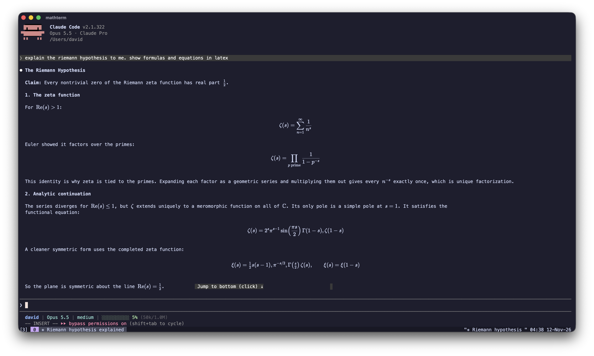
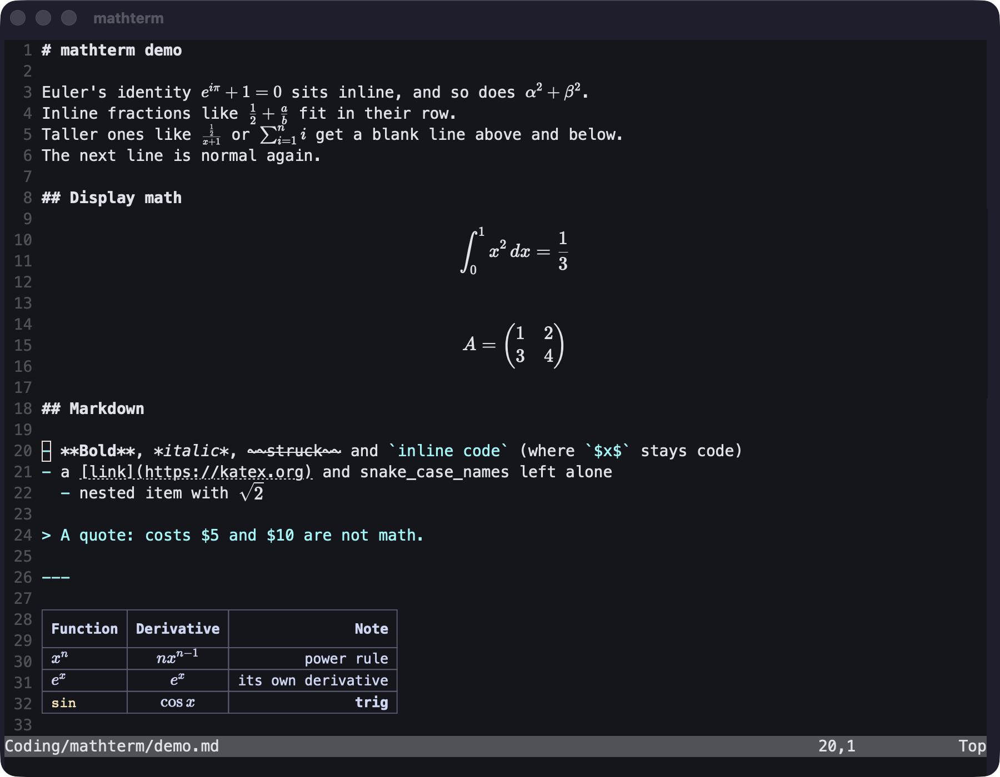
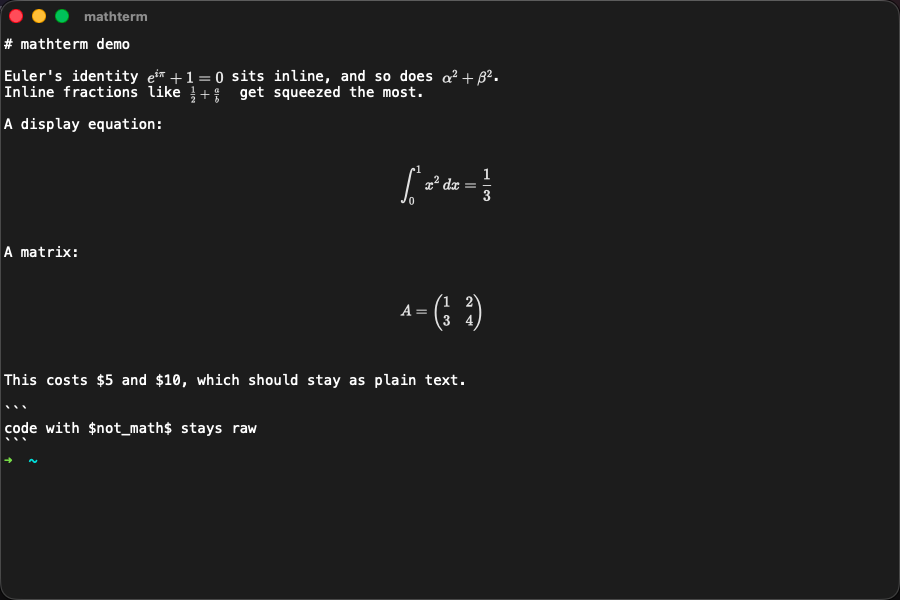

# mathterm

A terminal that typesets LaTeX. Any `$...$` that shows up on screen is rendered with KaTeX as real
vector text, the same way Obsidian or a browser shows it. That includes `cat` output, Claude Code's
replies, and the file you're editing in nvim. No plugins, and no cooperation from the program.

https://github.com/user-attachments/assets/fc305b93-685c-445c-b600-f4ab60ab0228



## How it works

mathterm is a normal terminal: xterm.js in a Tauri window, with your login shell in a pty. After every
redraw it scans the visible text for `$...$`, `$$...$$`, `\(...\)` and `\[...\]`. It then lays typeset
math over the cells where the source sits, in the source's own colors.

- **Editors:** the line under the cursor (or a `$$` block containing it) shows the raw LaTeX, so you can
  edit it, like Obsidian's live preview. Line numbers and splits are handled.
- **Room to breathe:** display math grows into the blank lines around it, which is how Claude Code and most
  markdown lay out equations, so it renders at full size instead of being squeezed into one row.
- **Few false positives:** `$5 and $10` stays text, code fences and `` `inline code` `` are skipped, and
  anything KaTeX can't parse is left alone.
- **Tables:** markdown tables (`| a | b |` with a `|---|` row) are drawn as real tables in their own
  rows, with column alignment and math, code, bold and italic in cells.
- **No gaps:** math usually renders narrower than its LaTeX source, so the text after it is redrawn
  flush against it.
- **Copy works:** the cells still hold the source, so copying an equation gives you its LaTeX.



Cmd-Shift-M toggles detection.

## Install

macOS only for now (Apple silicon and Intel).

1. Download `mathterm-macos.zip` from [Releases](https://github.com/davidlai3/MathTerm/releases) and unzip it.
2. Move `mathterm.app` to Applications.
3. The app isn't notarized by Apple yet, so macOS blocks the first launch. Right-click it and choose
   **Open**, or run:

   ```sh
   xattr -dr com.apple.quarantine /Applications/mathterm.app
   ```

`mdv` (below) is bundled and on mathterm's `PATH`. It needs Python 3 (`xcode-select --install` provides it).

### Build from source

Requires Node, Rust (`brew install rust`) and Python 3.

```sh
npm install
npm run app    # builds mathterm.app and installs it in /Applications
```

`npm start` runs it from source instead (dev mode).

## Config

`~/.config/mathterm/config.json`:

```json
{
  "theme": "catppuccin-mocha",
  "fontSize": 14,
  "fontFamily": "Menlo, monospace",
  "lineHeight": 1.2,
  "autoDetectIgnore": ["*.tex", "*.sty", "*.cls"],
  "autoDetectTables": true
}
```

Built-in themes are `default` and `catppuccin-mocha`. `theme` can also be an object with xterm.js theme
keys (`background`, `foreground`, `black` ... `brightWhite`) to use any other scheme.

`autoDetectIgnore` pauses math detection while the running program was opened on a matching file, e.g.
`nvim hw7.tex`, since a `.tex` source usually has its PDF next to it. Patterns are globs matched against the
file name of each argument, so program names work too (`"htop"`). The value shown is the default. With
nvim's `set title`, switching files with `:e` is picked up as well.

`autoDetectTables: false` turns off table rendering, e.g. if an editor plugin already draws tables. Math in
table rows is still typeset.

| Keys | |
|---|---|
| Cmd-N / Cmd-W | New / close window |
| Cmd-F | Find in scrollback (Enter / Shift-Enter: next / previous, Esc: close) |
| Ctrl-Cmd-F or Fn-F | Full screen |
| Cmd-+ / Cmd-- / Cmd-0 | Zoom in / out / reset |
| Cmd-Shift-M | Toggle math detection |
| Cmd-click | Open a link (hover shows the URL) |

## Add-on: `mdv`, a markdown viewer

Detection can only use the space a program already left for the math, so tall inline math between lines
of text is shrunk to fit its row. `mdv` is a small viewer (Python, stdlib only) that lays the page out itself:

```sh
mdv notes.md                         # styled markdown with typeset math
echo 'Euler: $e^{i\pi}+1=0$' | mdv   # or read from stdin
```



- Headings, bold/italic/strikethrough, lists, quotes, rules and clickable links.
- Tables with borders and alignment, sized correctly around math in cells.
- Syntax-highlighted code blocks (`pip3 install pygments` for better lexers; there's a built-in fallback).
- Exact math layout: no gaps after inline math, tall inline math gets its own spacing, and display math
  is centered.

`mdv` talks to mathterm through **OSC 7777**, a small private escape sequence for asking how big an equation
renders and drawing it in space the program reserved. The details are in
[notes/protocol.md](notes/protocol.md). In other terminals `mdv` still styles the markdown and leaves the
math as source. With output redirected (`mdv f.md > out`) it prints the file unchanged.

## Status

Early prototype, macOS only. Known gaps:

- Inline math split across rows by a program that wraps its own output (rather than the terminal wrapping it)
  stays raw LaTeX. Widening the window usually fixes it.
- Tall inline math with text directly above and below is shrunk to fit its row.
- TUIs that draw code blocks without backticks (Claude Code does) can get `$var$`-like text typeset.
- In `mdv`, tables wider than the window wrap and break their borders.

Detection is heuristic, so real examples help most. If something renders wrong, please
[open an issue](https://github.com/davidlai3/MathTerm/issues/new/choose) with the raw text.

## Roadmap

- **Detection polish:** check Claude Code's handling of inline `$...$` and `\(...\)`, and recognize code
  blocks drawn without backticks.
- **Live preview:** `mdv --watch` in a split pane, for the fully styled page beside your editor.

The [plans](notes/plans.md) and [changelog](notes/changelog.md) are in `notes/`.

## How this was built

mathterm was built with heavy use of AI: most of the code was written by Claude (Anthropic's model) through
Claude Code, from my direction, testing and bug reports. I set the design and priorities and checked every
change against real use (Claude Code chats, nvim, tmux). The development notes in [`notes/`](notes/) record
what was tried, what broke and why, including approaches that were reverted. Issues and PRs are welcome
either way.

## License

MIT, see [LICENSE](LICENSE).
